<div align="center">

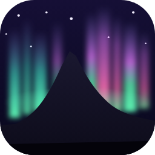

# Aurora

**Sua rotina inteira num app só, com uma assistente de IA que entende o que você fala.**

Rotina · Hábitos · Treino · Alimentação · Finanças · Objetivos · Anotações · Lembretes


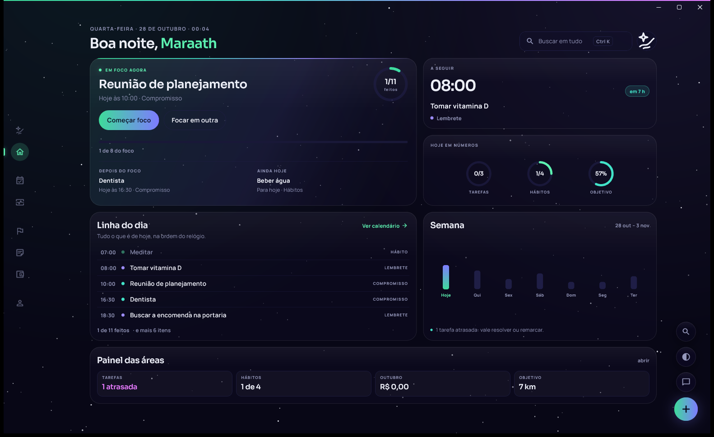

</div>

---

## Sumário

- [Sobre o projeto](#sobre-o-projeto)
- [Galeria](#galeria)
- [Funcionalidades](#funcionalidades)
- [Arquitetura](#arquitetura)
- [Decisões técnicas](#decisões-técnicas)
- [Qualidade](#qualidade)
- [Tecnologias](#tecnologias)
- [Estrutura do código](#estrutura-do-código)
- [Como rodar](#como-rodar)
- [Metodologia de desenvolvimento](#metodologia-de-desenvolvimento)
- [Licença](#licença)

## Sobre o projeto

O Aurora junta numa tela só o que normalmente fica espalhado em vários apps: tarefas, compromissos, hábitos,
gastos, treino, objetivos e anotações. Por cima de tudo há uma assistente, a **Aurora**, que entende pedidos em linguagem natural: *"gastei 35 no mercado"*, *"me lembra de pagar a luz amanhã às 9"* ou
*"como estão meus gastos este mês?"*.

É um app completo, publicado e em uso: **um único código Flutter** roda no **Windows, no Android e na web (PWA, que também instala no iPhone)**; a versão nativa para iOS está nos planos. O app
funciona **100% offline** e sincroniza entre aparelhos quando há internet. Tem instalador próprio, atualização
automática e um servidor com autenticação, banco protegido por usuário e IA.

| Versão atual | Código | Testes | Plataformas |
| :---: | :---: | :---: | :---: |
| **1.14.3** | ~46 mil linhas de Dart (fora o código gerado) | **307** automatizados | Windows · Android · Web (PWA) |

> **In English:** Aurora is a personal routine app (tasks, habits, appointments, workouts, nutrition, finances,
> goals, notes, reminders) with an AI assistant that creates and edits your data through tool calls. One Flutter codebase for
> Windows, Android and web (PWA, installable on iPhone); offline-first with SQLite (Drift), synced to Supabase (Postgres + Row Level
> Security); AI served by a Deno Edge Function with an automatic model fallback chain. Source-available under
> PolyForm Noncommercial 1.0.0.

**Experimentar:** [instalador para Windows](https://github.com/Maraath/aurora-instaladores/releases/download/baixar/Aurora-setup.exe) ·
[APK para Android](https://github.com/Maraath/aurora-instaladores/releases/download/baixar/Aurora.apk) ·
[versão web](https://aurora-ar2.pages.dev) (no iPhone, abra no Safari e use "Adicionar à Tela de Início").
Todas as versões, com o que mudou em cada uma, estão em [Releases](https://github.com/Maraath/aurora/releases).

## Galeria

> As imagens usam dados de demonstração gerados por [`tool/capturas`](tool/capturas/demonstracao.dart).

<table>
  <tr>
    <td width="50%">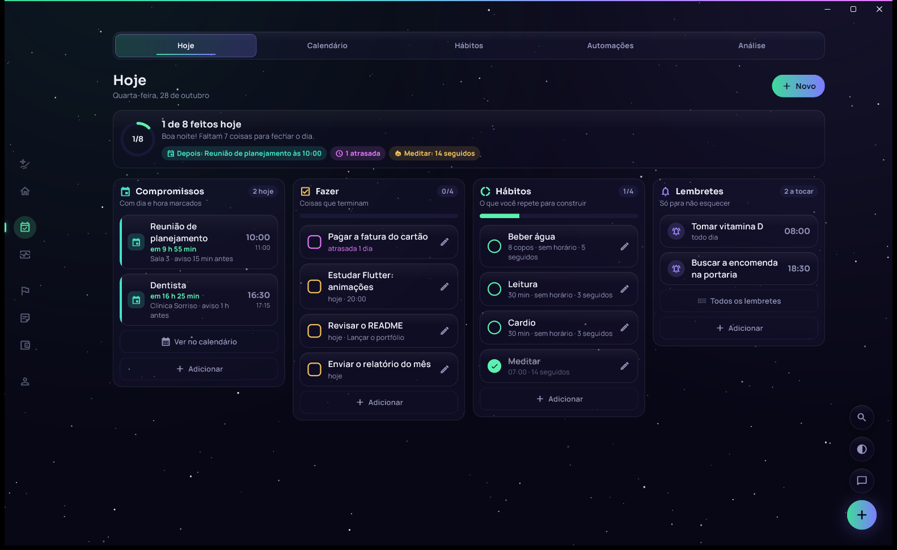<br><b>Rotina › Hoje</b>: compromissos, tarefas, hábitos e lembretes do dia em quatro colunas, cada tipo com a sua cor.</td>
    <td width="50%">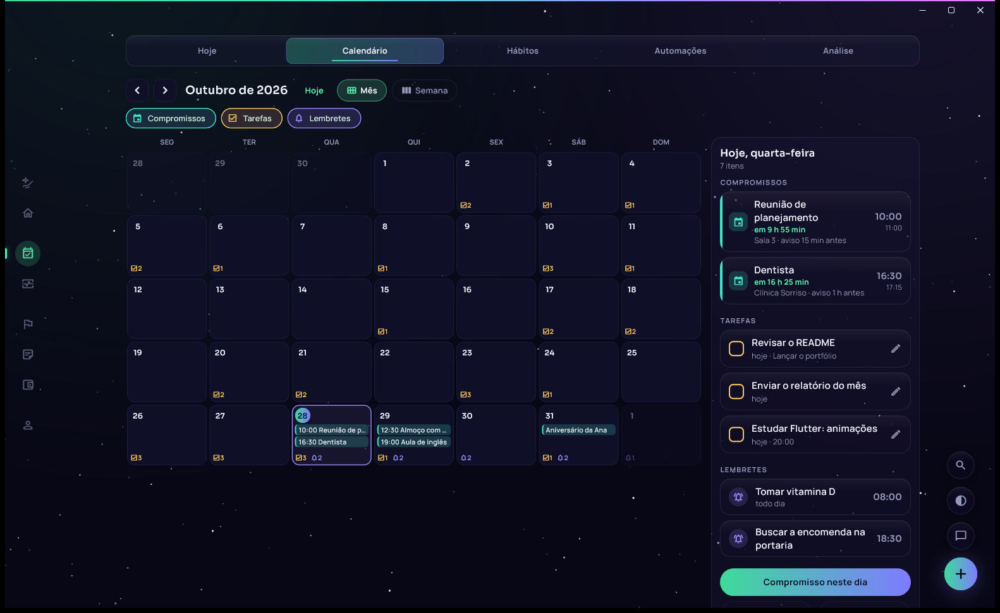<br><b>Calendário</b>: mês (ou semana em grade de horas) com o painel do dia ao lado; filtros por tipo.</td>
  </tr>
  <tr>
    <td>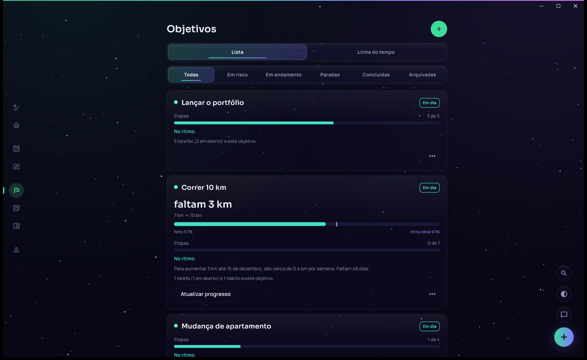<br><b>Objetivos</b>: metas com número (R$, km, livros) ou com etapas, ritmo ideal até a data e estado de cada uma.</td>
    <td>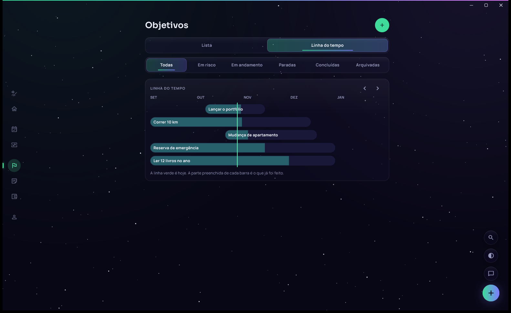<br><b>Linha do tempo</b>: todos os objetivos num Gantt, com o que já foi feito e a linha de hoje.</td>
  </tr>
  <tr>
    <td>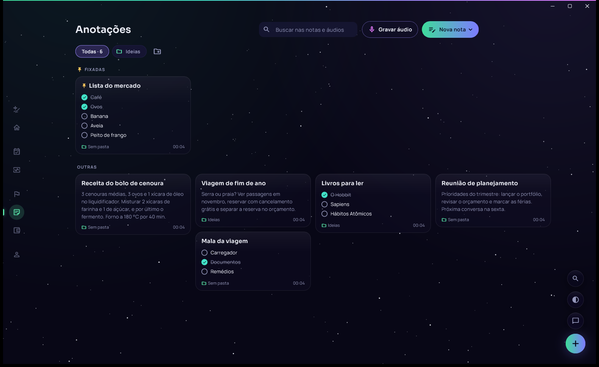<br><b>Anotações</b>: mural de notas, listas com caixinhas, fotos e áudios transcritos, com pastas e notas fixadas.</td>
    <td>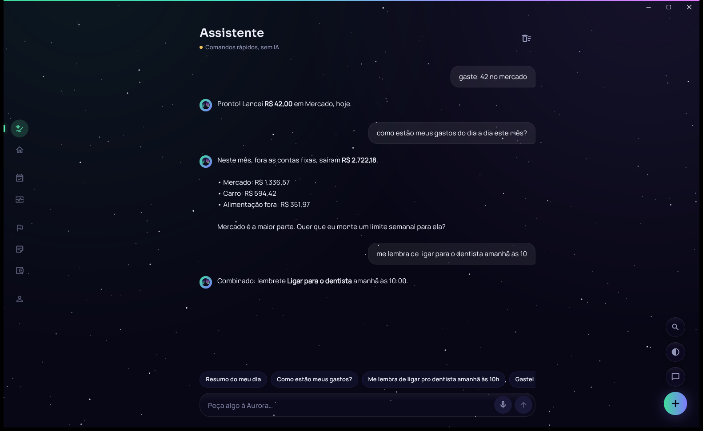<br><b>Assistente</b>: pedidos em linguagem natural viram lançamentos, lembretes e respostas com os seus dados.</td>
  </tr>
  <tr>
    <td>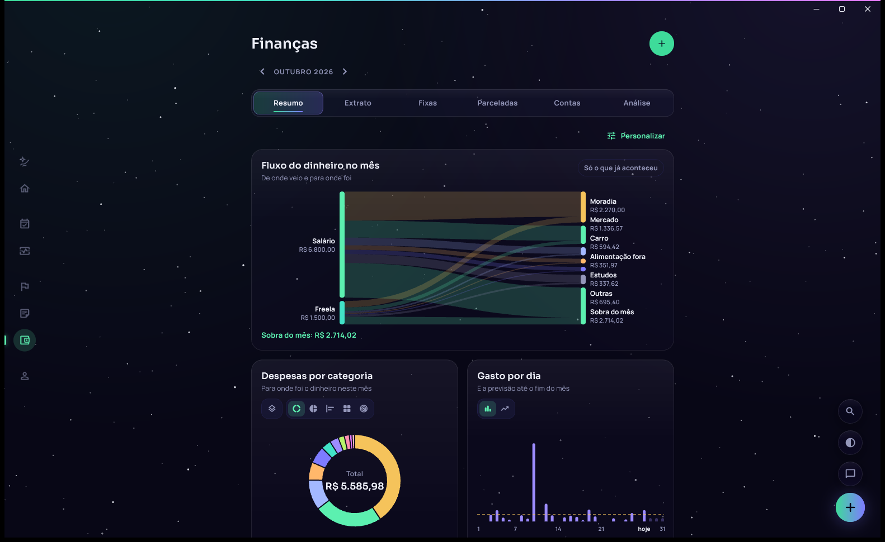<br><b>Fluxo do dinheiro</b>: diagrama de Sankey de onde o dinheiro veio e para onde foi.</td>
    <td>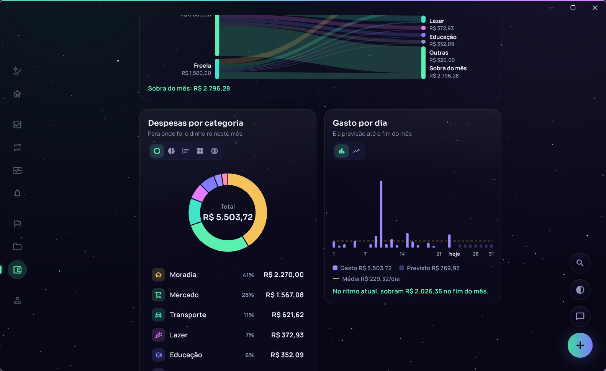<br><b>Despesas e gasto por dia</b>: 25 categorias com ícone e cor; cada gráfico troca de tipo e pode somar por grupo.</td>
  </tr>
  <tr>
    <td>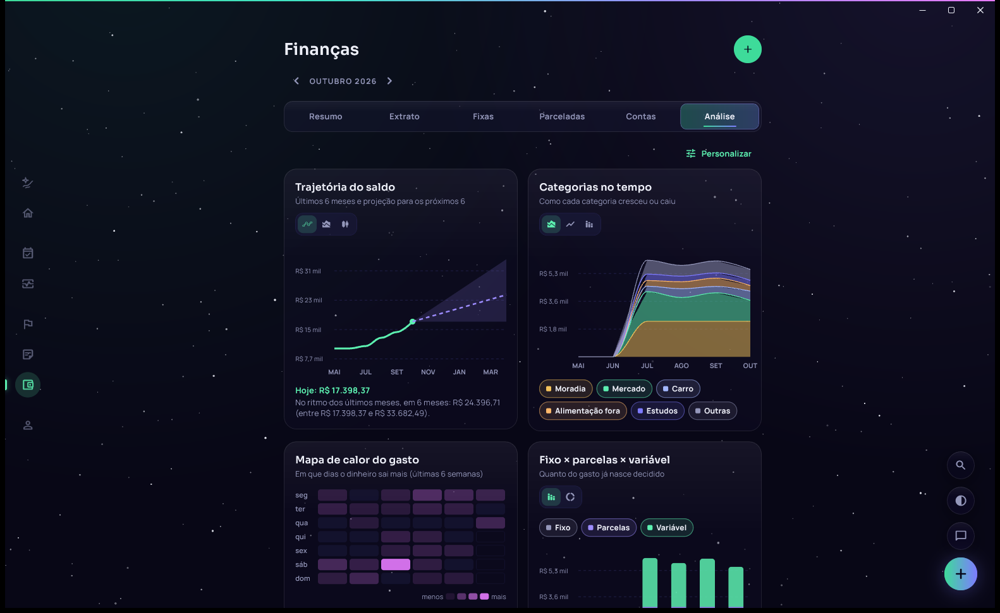<br><b>Análise</b>: trajetória do saldo com projeção, categorias no tempo, mapa de calor e fixo × parcelas × variável.</td>
    <td>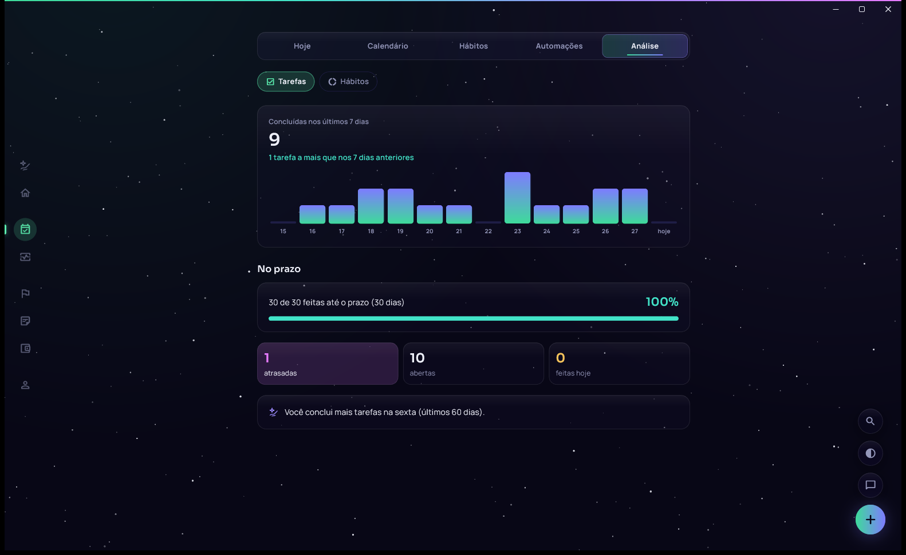<br><b>Análise da Rotina</b>: tarefas concluídas por dia, cumprimento de prazo e constância dos hábitos.</td>
  </tr>
  <tr>
    <td>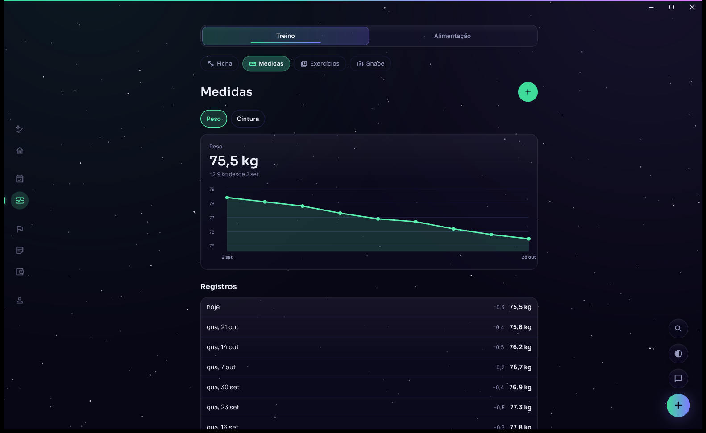<br><b>Saúde</b>: ficha de treino com carga sugerida, medidas, fotos de evolução e dieta.</td>
    <td>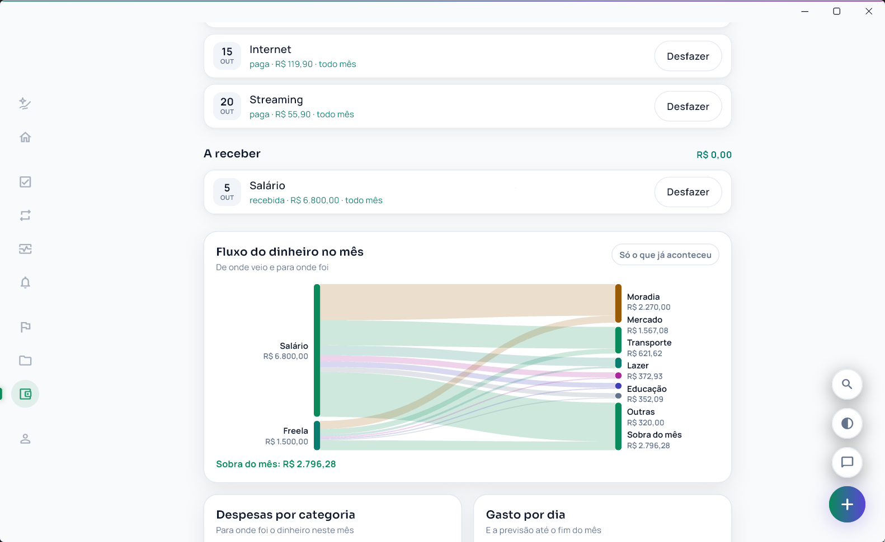<br><b>Tema claro</b>: a mesma paleta de aurora boreal, em versão diurna.</td>
  </tr>
</table>

<div align="center">
  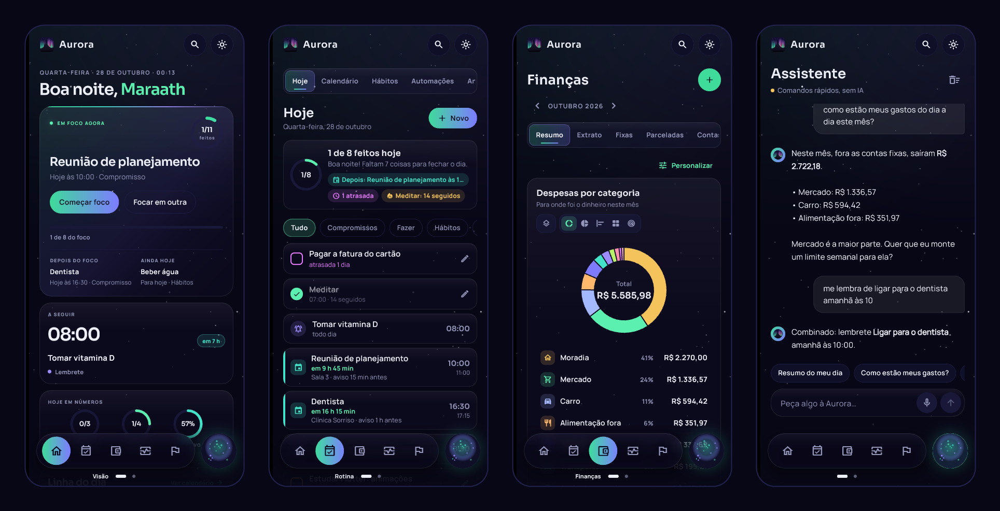<br>
  <sub><b>No celular</b>: barra flutuante de vidro só com ícones (duas páginas), a orbe que abre a assistente e as mesmas telas adaptadas.</sub>
</div>

## Funcionalidades

| Área | O que faz |
| --- | --- |
| 🌌 **Visão** | O dia em blocos: **em foco** com o anel do dia e a fila do que vem depois, **a seguir** com a hora do próximo item, **hoje em números** em anéis, **linha do dia**, **semana** com leituras automáticas e o painel das áreas. Busca em tudo no cabeçalho (Ctrl+K). |
| 📅 **Rotina** | Tarefas, hábitos, lembretes e **compromissos** numa área só, com as abas Hoje, Calendário, Hábitos, Automações e Análise. Compromisso tem início e fim (ou dia inteiro), local, repetição (até "todo ano") e aviso antes. Um formulário único cria qualquer tipo, e trocar o tipo ao editar converte o item (com "Desfazer"). |
| 🗓️ **Calendário** | Visão de mês (com os itens dentro do dia ou em pontinhos no celular) e de semana em grade de horas, painel do dia ao lado e filtros por tipo. |
| 🔁 **Hábitos** | Marcar, por duração ou por quantidade; dias da semana, sequências, recordes e constância. Tarefas repetidas antigas viram hábitos sozinhas, com o histórico. |
| 🎯 **Objetivos** | Metas e projetos juntos: progresso por número (R$, kg, km, livros ou unidade livre) ou por **etapas que viram tarefas**. Mostra o ritmo por semana até a data e o estado (em dia, em risco, parada, pausada, concluída, arquivada), com lista, filtros e **linha do tempo**. |
| 📝 **Anotações** | Mural em colunas com notas de texto, **listas com caixinhas**, fotos e **áudios gravados no app com transcrição**. Pastas, notas fixadas, busca nas notas e nas transcrições, painel ao lado no computador e "Desfazer" ao apagar. Funciona também na web. |
| 💰 **Finanças** | Lançamentos, contas fixas e parceladas e várias contas. **25 categorias em 8 grupos** (com Investimentos, Dívidas e juros, Cuidados pessoais e Serviços); a categoria é sugerida enquanto você digita a descrição, os chips mostram as mais usadas, e "Revisar" tira os lançamentos de "Outros" com um toque. Painéis de gráficos personalizáveis: fluxo do dinheiro (Sankey), categorias (por categoria ou por grupo), gasto por dia, fluxo de caixa, trajetória com projeção, mapa de calor e mais. |
| 💪 **Saúde** | Ficha de treino com 470 exercícios animados, carga sugerida, medidas, fotos de evolução e dieta com a tabela TACO. |
| 🔔 **Lembretes** | Avisos locais, Web Push no PWA e despertador de tela cheia no Android, que toca mesmo no silencioso. |
| ✨ **Assistente** | Texto e **voz** (microfone no campo, transcrição na nuvem) e **resposta falada** com a voz do próprio aparelho (só quando você falou, sempre ou nunca). Cria, edita e exclui lançamentos, tarefas, lembretes, compromissos e treinos com confirmação e "Desfazer"; sem internet, comandos rápidos por regras. |
| 🔎 **Extras** | Busca global (Ctrl+K), atalhos flutuantes com captura rápida e mini chat, bloqueio por PIN ou biometria, tema escuro e claro, efeitos visuais leves para aparelhos mais fracos, fotos só no aparelho ou na nuvem (privadas, comprimidas e sem metadados), e datas e avisos sempre no fuso de onde você está. |

## Arquitetura

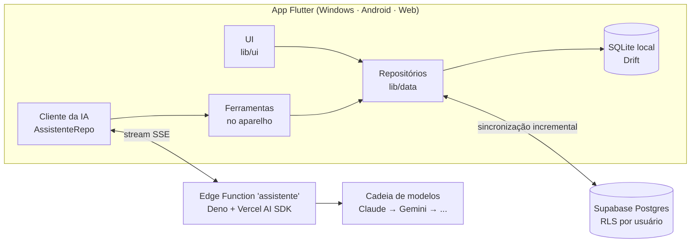

1. **O banco local é a fonte da verdade.** Toda tela lê e grava no SQLite do aparelho; a rede nunca bloqueia o uso.
2. **A sincronização** envia o que mudou e baixa o que mudou no servidor desde a última vez (cursor por
   `servidor_em`), com a regra "última edição vence".
3. **A IA não executa nada no servidor.** A Edge Function só conversa com o modelo; quando ele pede uma ferramenta
   (criar lançamento, editar tarefa, consultar dados), o pedido volta ao app, que executa no banco local e devolve o
   resultado. Isso mantém os dados no aparelho e o "Desfazer" funcionando.

## Decisões técnicas

<details>
<summary><b>Offline-first com Drift</b></summary>

O app precisava funcionar no metrô, na academia e sem sinal. Por isso o SQLite (via Drift, com tipos gerados e
migrações versionadas) é a fonte da verdade, e a nuvem é só um espelho. Na web, o mesmo banco roda em WebAssembly
com IndexedDB.
</details>

<details>
<summary><b>Recorrência como regra, não como linhas</b></summary>

Tarefas, hábitos, contas fixas e lembretes recorrentes guardam uma **regra** (no estilo RRULE do calendário) que
gera as ocorrências na hora. Só o que foi feito vira linha. Isso evita a pilha de tarefas atrasadas repetidas e
mantém o banco pequeno.
</details>

<details>
<summary><b>Dinheiro em centavos e datas no fuso de quem usa</b></summary>

Valores são inteiros em centavos (sem erro de arredondamento de ponto flutuante) e todas as datas são interpretadas
no fuso do aparelho (lido em nome IANA, como `Europe/Lisbon`, com São Paulo como reserva). Se a pessoa viaja e
o fuso muda, o app percebe ao voltar à tela e recalcula os avisos no horário novo.
</details>

<details>
<summary><b>Segurança no servidor</b></summary>

Todas as tabelas têm Row Level Security por usuário e permissões mínimas por papel (`authenticated` e
`service_role`). A chave da IA nunca fica no app: vive nos segredos da Edge Function. Fotos do usuário ficam num
balde privado, acessadas só por URL assinada de 1 hora, e são comprimidas em WebP sem metadados (EXIF) antes de
sair do aparelho.
</details>

<details>
<summary><b>IA resiliente com cadeia de modelos</b></summary>

A Edge Function tenta os modelos em ordem. Se um responde com limite de cota, erro ou demora a começar, o próximo
assume **antes** de qualquer texto chegar ao app, então a pessoa nem percebe a troca. Modelos lentos são chamados em
paralelo com o próximo e fica o primeiro que responder. O protocolo de streaming é o mesmo do `useChat` da Vercel AI
SDK, implementado em Dart.
</details>

<details>
<summary><b>Integração nativa em cada plataforma</b></summary>

- **Windows**: barra de título própria desenhada em Flutter, com o runner em C++ tratando `WM_NCHITTEST` para manter
  arrastar, snap layouts do Windows 11 e duplo clique; voz pelo SAPI.
- **Android**: alarmes exatos com tela cheia (despertador) e APK por arquitetura.
- **Web/iPhone**: PWA com Service Worker próprio, área segura do iPhone e Web Push agendado pelo servidor (pg_cron).
- **Distribuição**: instalador Inno Setup e atualização automática dentro do app, com verificação de SHA-256.
</details>

## Qualidade

- **307 testes automatizados** (widgets e regras de negócio): recorrência, rotina e compromissos, objetivos,
  anotações, finanças e categorias, sincronização, assistente, voz, gráficos, busca e mais.
- `flutter analyze` sem nenhum aviso.
- Migrações do servidor versionadas em [`supabase/migrations`](supabase/migrations), testadas num banco local antes
  de ir para produção.
- Backup semanal automático do banco do servidor.

```bash
flutter test      # roda os 307 testes
flutter analyze   # análise estática
```

## Tecnologias

| Camada | Tecnologias |
| --- | --- |
| App | Flutter, Dart, Drift (SQLite), fl_chart |
| Servidor | Supabase (Auth, Postgres, Storage, Edge Functions), pg_cron |
| IA | Vercel AI SDK, Claude (Anthropic), Gemini (Google), TypeScript/Deno |
| Nativo | C++ (runner do Windows), Kotlin/Gradle (Android) |
| Entrega | Inno Setup, GitHub Releases, Cloudflare Pages, scripts PowerShell |

## Estrutura do código

| Pasta | Conteúdo |
| --- | --- |
| [`lib/ui`](lib/ui) | telas e componentes (vidro, céu estrelado, menu em dock, gráficos) |
| [`lib/data`](lib/data) | banco, repositórios, sincronização, análises e o cliente da IA ([`lib/data/ia`](lib/data/ia)) |
| [`lib/core`](lib/core) | tema, notificações, bloqueio, atualização, efeitos |
| [`supabase/functions`](supabase/functions) | Edge Functions: `assistente`, `avisos-push`, `excluir-conta` |
| [`supabase/migrations`](supabase/migrations) | esquema do servidor, RLS e permissões |
| [`test`](test) | testes de widgets e de regras |
| [`tool`](tool) | scripts de ícone, publicação, backup, capturas e conversão de dados |
| [`docs`](docs) | especificação, protótipo de referência e imagens |

## Como rodar

Pré-requisitos:

- [Flutter](https://docs.flutter.dev/get-started/install) 3.47 ou mais novo (`flutter doctor` sem erros para a
  plataforma que for usar).
- **Windows:** Visual Studio 2022 (ou Build Tools) com "Desenvolvimento para desktop com C++" e o componente **ATL**
  (o plugin de notificações exige), `nuget.exe` no PATH (o plugin de voz exige) e o **Modo de Desenvolvedor** do
  Windows ligado. Se o nome do seu usuário do Windows tem espaço, ponha o cache do Flutter fora do perfil
  (`PUB_CACHE=C:\src\pub-cache`), senão o build quebra.
- **Android:** Android SDK e JDK (os do Android Studio servem). Sem `android/key.properties`, o APK sai assinado com a
  chave de depuração.

```bash
flutter pub get
dart run build_runner build
flutter run -d windows
```

O app abre vazio e funciona offline. Para ver com os dados de demonstração das imagens, num banco separado:

```bash
flutter run -d windows -t tool/capturas/main.dart --dart-define=AURORA_BANCO=aurora_capturas
```

**Servidor.** Sem nada configurado, a conta, a sincronização e a assistente usam o projeto Supabase do autor (a chave
que vai no app é a pública `anon`; os dados de cada conta são protegidos por RLS). Para usar o seu próprio projeto:

1. Crie um projeto no [Supabase](https://supabase.com) e aplique as migrações: `npx supabase link` e
   `npx supabase db push`. Antes, troque o endereço do projeto do autor no agendamento dos avisos
   (`supabase/migrations/20261020200000_avisos_push.sql`).
2. Publique as Edge Functions (`npx supabase functions deploy assistente`, `excluir-conta` e, com
   `--no-verify-jwt`, `avisos-push`) e cadastre os segredos que elas leem: `GEMINI_API_KEY` e/ou
   `ANTHROPIC_API_KEY` para a IA, `VAPID_PUBLICO`/`VAPID_PRIVADO` para os avisos da web
   (`tool/push/gerar_chaves.ps1` gera).
3. Rode o app apontando para ele:

```bash
flutter run -d windows --dart-define=AURORA_SUPABASE_URL=https://SEU-PROJETO.supabase.co --dart-define=AURORA_SUPABASE_CHAVE=SUA-CHAVE-ANON
```

O login com Google, a chave pública dos avisos da web (`chavePublicaAvisos`) e as atualizações automáticas
continuam configurados para o projeto do autor.

## Metodologia de desenvolvimento

O Aurora é um projeto meu, do início ao fim. Ele foi construído com práticas de **AI-Assisted Development**, usando
o [Claude Code](https://claude.com/claude-code) (Anthropic) como ferramenta de *pair programming* para acelerar a
escrita do código. A arquitetura, as decisões de design, as regras de negócio, a validação de cada funcionalidade e
os testes foram definidos e conferidos por mim. Por isso os commits trazem o Claude como coautor
(`Co-Authored-By`): ele foi a ferramenta, e a autoria e as decisões do projeto são minhas.

> **Development methodology:** built with AI-assisted development, using Claude Code as a pair-programming tool to
> speed up coding. Architecture, design decisions, business rules, validation and tests were defined by me.

## Licença

Copyright © 2026 Maraath. Código disponível sob a [PolyForm Noncommercial 1.0.0](LICENSE): pode ler, estudar,
modificar e usar para fins **não comerciais**. Uso comercial só com autorização do autor.
Contribuições: ver [CONTRIBUTING.md](CONTRIBUTING.md).

Conteúdo de terceiros: fontes Sora e Manrope (SIL Open Font License); dados de alimentos da Tabela Brasileira de
Composição de Alimentos (TACO), 4ª edição, NEPA/Unicamp, 2011. As animações dos exercícios não fazem parte deste
repositório. Detalhes em [docs/licencas.md](docs/licencas.md).
